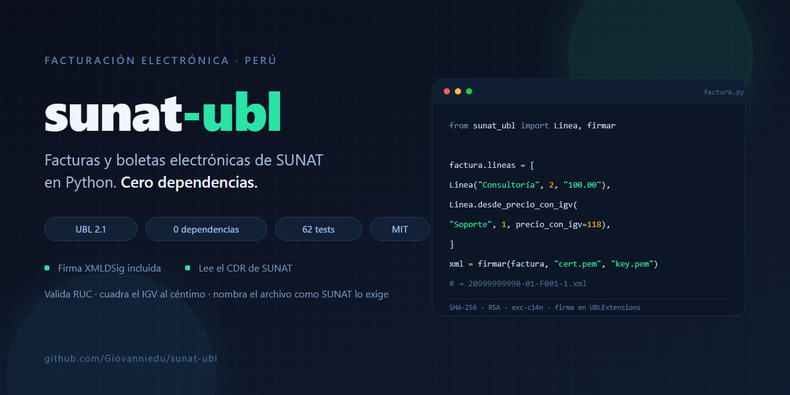
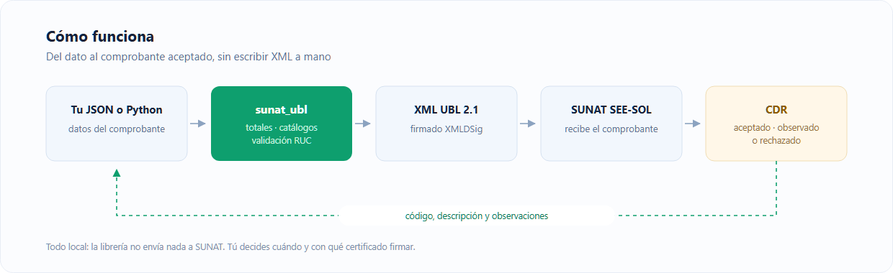

<div align="center">
  
</div>

# sunat-ubl

[](https://github.com/Giovanniedu/sunat-ubl/actions)
[](https://pypi.org/project/sunat-ubl/)
[](LICENSE)
[](pyproject.toml)

Genera el **XML UBL 2.1** de facturas y boletas electrónicas del Perú, lo **firma digitalmente**
y lee el **CDR** de SUNAT. El núcleo no tiene dependencias: solo la librería estándar de Python.



## Por qué existe

Integrar con el SEE-SOL de SUNAT obliga a armar a mano un XML UBL 2.1 con namespaces, catálogos
de afectación del IGV y reglas de redondeo que, si se equivocan por un céntimo, terminan en un
rechazo con un código y sin explicación útil. Esta librería resuelve esa capa:

- **Cuadratura exacta.** Si partes de un precio con IGV (100.00), la base queda en 84.75 y el IGV
  en 15.25, no en 15.26. Base + IGV siempre suma lo que paga el cliente.
- **Firma digital XMLDSig** (RSA-SHA256, SHA-256, exc-c14n) insertada en `ext:UBLExtensions`,
  que es donde la exige SUNAT.
- **Catálogos oficiales**: afectación del IGV (10, 20, 30, 40), tributos (1000, 9995, 9997, 9998),
  tipos de documento de identidad y unidades de medida.
- **Nombre de archivo correcto**: `RUC-TIPO-SERIE-NUMERO.xml`.
- **Validación temprana** de RUC (módulo 11), DNI, series y montos, con mensajes en español.
- **CDR**: lee el ZIP o el XML que devuelve SUNAT y expone código, descripción y observaciones.

## Instalación

```bash
pip install sunat-ubl                 # núcleo, sin dependencias
pip install "sunat-ubl[firma]"        # + firma digital (signxml, lxml)
```

## Uso rápido

```python
from datetime import date
from sunat_ubl import Cliente, Comprobante, Emisor, Linea, guardar

factura = Comprobante(
    tipo="01", serie="F001", numero=1, fecha=date(2026, 10, 30),
    emisor=Emisor(ruc="20999999990", razon_social="SERVICIOS DEMO PERU SAC"),
    cliente=Cliente(tipo_doc="6", numero="20512345671", razon_social="CLIENTE SAC"),
    lineas=[
        Linea("Consultoría", cantidad=2, valor_unitario="100.00", unidad="ZZ"),
        Linea.desde_precio_con_igv("Soporte", cantidad=1, precio_con_igv=118),
        Linea("Servicio exonerado", cantidad=1, valor_unitario="50.00", tipo_afectacion="20"),
    ],
)
guardar(factura, "salida")  # salida/20999999990-01-F001-1.xml
```

## Firma digital

El XML sale sin firmar por defecto. Para firmarlo necesitas el certificado digital de tu empresa
(PEM) y su clave privada:

```python
from sunat_ubl import firmar, firmar_xml, verificar_firma

xml_firmado = firmar(factura, "certificado.pem", "clave.pem")
# o firma un XML ya generado:
xml_firmado = firmar_xml(open("20999999990-01-F001-1.xml", "rb").read(), "certificado.pem", "clave.pem")

verificar_firma(xml_firmado, "certificado.pem")  # True si nadie lo alteró
```

- La firma se inserta en `ext:UBLExtensions/ext:ExtensionContent` (posición que exige SUNAT).
- Algoritmos: `rsa-sha256`, digest `sha256`, canonicalización exclusiva C14N.
- El documento firmado no se reindenta: cualquier cambio de espacios invalidaría la firma.

## CLI

```bash
sunat-ubl generar examples/factura.json -o salida
sunat-ubl generar examples/factura.json -o salida --cert cert.pem --clave key.pem
sunat-ubl firmar factura.xml --cert cert.pem --clave key.pem [-o salida.xml]
sunat-ubl cdr R-20999999990-01-F001-1.zip
sunat-ubl ruc 20100070970
```

```
$ sunat-ubl cdr R-20999999990-01-F001-1.zip
ACEPTADO CON OBSERVACIONES (0): El comprobante fue registrado exitosamente
comprobante: F001-1
observación: 2335 - El comprobante fue aceptado
```

## Formato JSON

`examples/factura.json` es un ejemplo completo. Las líneas aceptan `valor_unitario` (sin IGV) o
`precio_con_igv` (lo que paga el cliente):

```json
{
  "tipo": "01", "serie": "F001", "numero": 1,
  "fecha": "2026-10-30", "hora": "15:42:10", "moneda": "PEN",
  "emisor":  { "ruc": "20999999990", "razon_social": "SERVICIOS DEMO PERU SAC" },
  "cliente": { "tipo_doc": "6", "numero": "20512345671", "razon_social": "CLIENTE SAC" },
  "lineas": [
    { "descripcion": "Consultoría", "cantidad": 2, "valor_unitario": 100.0, "unidad": "ZZ" },
    { "descripcion": "Soporte", "cantidad": 1, "precio_con_igv": 118.0, "unidad": "ZZ" }
  ]
}
```

## Qué hace y qué no

| Sí | Todavía no |
| --- | --- |
| XML UBL 2.1 de factura (01) y boleta (03) | Notas de crédito (07) y débito (08) |
| IGV, exonerado, inafecto y exportación | ISC e ICBPER |
| Firma digital XMLDSig | Envío al SEE-SOL (SUNAT solo acepta SOAP con certificado) |
| Lectura de CDR | Validación contra el XSD oficial de SUNAT |
| Totales, catálogos y validaciones | |

> **Honestidad primero:** la estructura del XML sigue el estándar UBL 2.1 y la firma verifica
> criptográficamente, pero este proyecto todavía **no ha sido validado contra el XSD oficial de
> SUNAT ni probado en el SEE beta**. Si vas a emitir comprobantes reales, pruébalo primero en el
> entorno beta del contribuyente con tu certificado.

## API

```python
from sunat_ubl import a_xml, construir, guardar, leer_cdr, validar_ruc

xml_bytes = a_xml(factura)           # bytes UTF-8 sin firmar
raiz = construir(factura)            # xml.etree.ElementTree.Element
cdr = leer_cdr("R-...-CDR.zip")
cdr.aceptado, cdr.codigo, cdr.notas, cdr.referencia
```

## English summary

`sunat-ubl` generates the UBL 2.1 XML required by SUNAT (Peru's tax authority) for electronic
invoices and sales receipts, signs it with XMLDSig, and reads the CDR response. The core has
**zero dependencies**; signing is an optional extra. It handles IGV rounding edge cases (the
"1 céntimo" mismatch), validates RUC/DNI/series, and produces the exact filename SUNAT expects.

## Desarrollo

```bash
python -m venv .venv && source .venv/bin/activate   # Windows: .venv\Scripts\activate
pip install -e ".[dev]"
pytest                                                # 62 tests
```

## Licencia

MIT. Ver [LICENSE](LICENSE).
